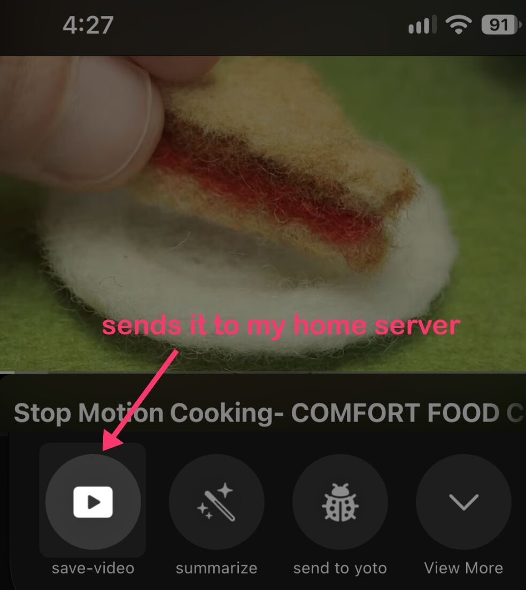
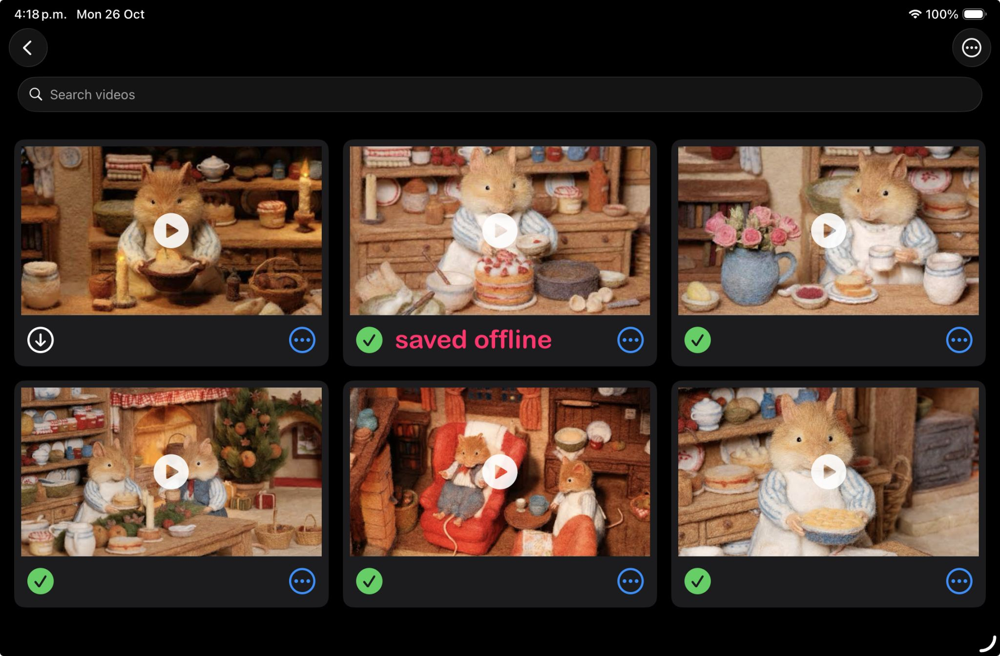
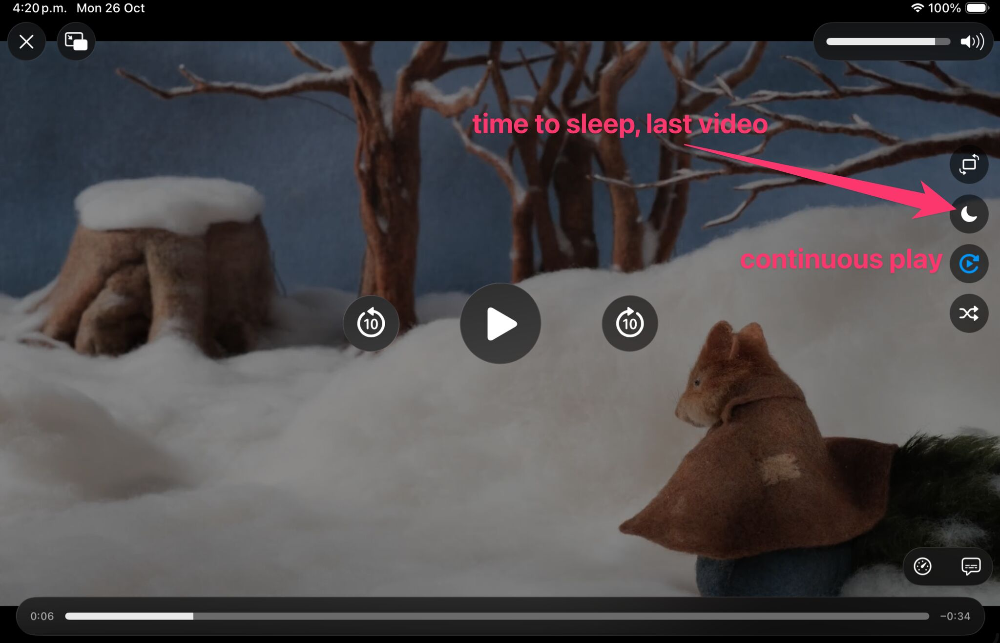

# PatataTube

**A video player for kids that only plays what you picked, and ends when you say it ends.**

PatataTube is a self-hosted "watch later" with an iPad app built for one tiny, demanding user: my daughter.

<p align="center">
  
  
  
</p>

<p align="center"><sub>
  Send a video from YouTube, pick it from a group with one tap, and let the player end things for you.
</sub></p>

## The problem

When I need my daughter to sit still (doing her hair, cutting her nails), I make an exception to our no-screens rule and play something calm. Usually 90's stop motion, like Brambly Hedge.

But YouTube shows her a dozen other videos around the one she's watching. Even with autoplay off, she'd cry and fight to watch the one with Pikachu in it. I don't control YouTube's UI, so every time it turned into an argument over one more video.

PatataTube takes the UI back. She sees only the videos I chose, nothing else, and the video ends when it ends.

## What it does

- **Video groups.** Videos live in groups, and she picks one herself with a single tap. No search, no recommendations, no rabbit hole.
- **Continuous play.** The video ends before her hair is done? The next one in the group starts by itself. Shuffle is a toggle.
- **"Time to sleep, last video".** One button that turns the iPad off as soon as the current video ends. She gets closure, without drama.
- **Offline videos.** Bathroom WiFi is terrible. Tap download and a video is saved to the iPad, and it can start playing from a partially downloaded file. Downloads can be paused and survive the app being closed.
- **Audio-only mode.** Inside a group, the list plays sound without the picture, for when she only needs something to listen to.
- **Send a video from anywhere.** An iOS Shortcut sends a YouTube or Twitter/X link (or a whole YouTube playlist) to my home server. It downloads the video, re-encodes it so iOS can stream it, and it shows up in the app.
- **A new-video badge** on each group, so she (and I) can see what hasn't been watched yet.
- **Smart inbox.** Videos sent without a group are sorted into the right one by an AI classifier, based on title, channel and description. Anything it isn't confident about waits in the inbox.

## How it came to be

Every feature came from watching one user run into the next problem:

1. She fought over other videos → **groups**, so she chooses with one tap.
2. The video ended before her hair was done → **continuous play**.
3. Another video started when I was finished → **"time to sleep, last video"**.
4. The videos had to come from somewhere → **a Shortcut and a home server** that fetch them from YouTube.
5. The bathroom WiFi was terrible → **offline downloads**, including playing a partial file.

Most of it was built with Claude.

## How it works

```
 iOS Shortcut ──► FastAPI server (always-on, at home) ──► iPad app (SwiftUI)
   (a URL)          downloads, re-encodes to H.264/AAC,       groups, playback,
                    streams over HTTP Range                 offline cache
```

- `main.py`, `downloader.py`, `converter.py`: the backend. It downloads with yt-dlp and pybalt, and a single converter process runs every ffmpeg job.
- `ios/`: the SwiftUI iPad app, plus `PatataTubeKit`, the package that holds its logic.
- A server-rendered web page (installable as a PWA) shows the same library in a browser.
- `/sd` is a plain-HTTP player for a first-generation iPad.

## Run it yourself

You need a Mac or Linux box that stays on, Python 3.13, ffmpeg and yt-dlp.

```bash
cp .env.example .env   # set UPLOAD_TOKEN
python3.13 -m venv python_env && python_env/bin/pip install -r requirements.txt
./serve                # http://localhost:3050
```

Build and install the iPad app with `./deploy` (see [`ios/install.md`](ios/install.md)), or open the project with:

```bash
cd ios/PatataTube && xcodegen generate && open PatataTube.xcodeproj
```

More detail:

- [`CLAUDE.md`](CLAUDE.md): architecture and design decisions
- [`ios/README.md`](ios/README.md): the iOS feature list and manual test checklist
